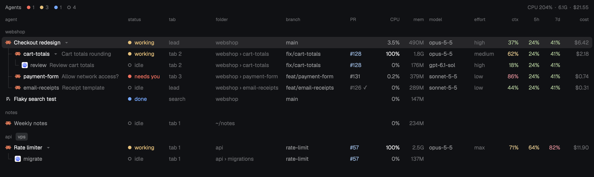
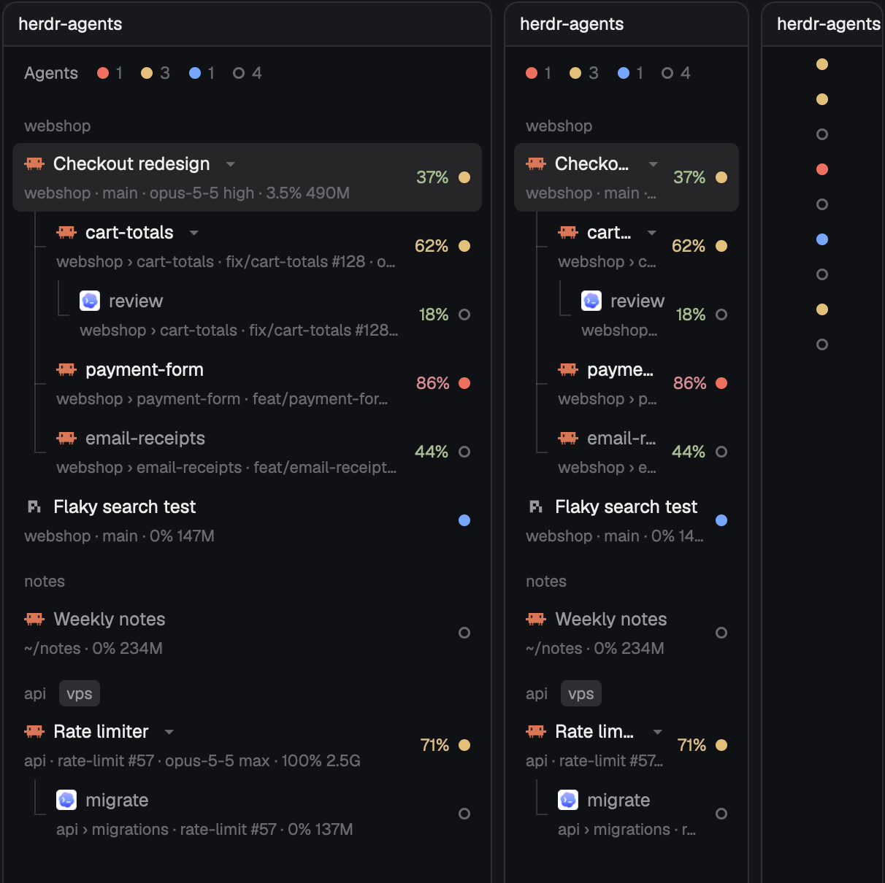

# herdr-agents

A mod for [Herdr.app](https://herdr.dev): every agent terminal as one row, on every machine
Herdr knows. It works by itself, and shows more when
[agent-telemetry](https://github.com/evgenyt1/agent-telemetry) files are present.



## What it shows

One row for each terminal Herdr calls an agent (Claude Code, Codex, pi, any program that
reports a status), sub-agents indented under the agent that started them, grouped by space.

Always:

| Column | What |
| --- | --- |
| agent | The terminal's name and title, with the program's icon. |
| status | working, needs you, done or idle, in Herdr's own colors. |
| tab | The tab it is in; a sub-agent without a pane of its own is in its parent's tab. The space is named too when the row is listed under another space. |
| dir | The repository, then the worktree and the folder below it. Outside a repository, the path. Click it to open the folder in VS Code; the list stays as it is. |
| git | What has changed in the checkout: `+3` staged, `~1` modified, `?2` untracked, `!1` in conflict, `↑2` ahead of and `↓1` behind its upstream, `✓` when there is nothing to say. Each mark has a color. |
| branch | The git branch there; `@abc1234` when a commit is checked out. |
| PR | The branch's pull request: open, draft (muted) or merged (`✓`). Click it to open it. |
| CPU, mem | Of the agent's process and everything it started. CPU is the load over the last 20 seconds or so (a minute on Linux, where `ps` counts CPU time in whole seconds), 100% being one core. |

With agent-telemetry, for each terminal a file matches:

| Column | What |
| --- | --- |
| model/effort | The model of the last request and its reasoning effort, as `opus-5.5/xhigh`. Each has a color of its own, from green to red: the model by its size (haiku or mini, sonnet, opus, fable; for Codex mini, the plain model, max or sol), the effort from low to max. |
| ctx | How full the context is, from green at 0% through yellow at 50% to red at 100%. |
| 5h | How much of the five-hour limit is used, in the same colors. |

The colors are the theme's own green, yellow and red and what lies between them.

The columns stand in this order: status, model/effort, ctx, tab, dir, git, branch, PR, CPU,
mem, 5h. A column nobody has anything for is left out, so without telemetry files there
are no telemetry columns. The table starts at the left edge; in a block too narrow for it, it
scrolls sideways, and in a wider one the rest stays empty. Under 520 px each agent takes two
lines; under 110 px only the status dots stay.

The footer shows local CPU and memory, available system readings, the highest context usage,
plan limits (including 7d) with reset times, and the total reported cost of the listed sessions.
The CPU and memory figures in brackets cover agents on the local machine. The footer scrolls
sideways when it exceeds the available width.

Drag the line at the right edge of a heading, the agent's too, to make that column wider or
narrower; the columns right of it move along. A double-click on the line makes the column as
wide as what is in it. The widths are kept, for each place the mod is shown: the one opened
over the window has them again the next time it opens.

The mod opens as it was: the same columns in the same places from the first frame, filled with
what was last read, while the fresh readings come in.



Click a row, or press Enter on it, to go to that agent. Arrows or `j` / `k` move, starting
from the agent you are in, and Left and Right fold and unfold an agent's sub-agents. A folded agent says how many it hides, in the
color of the most urgent one, and they stay in the counts at the top.

## Install

Needs Herdr.app. `git` and `gh` are used when they are there, and VS Code's `code` command to
open a folder.

```sh
git clone https://github.com/evgenyt1/herdr-agents
cd herdr-agents
./install.sh
```

This copies `mods/herdr-agents` into Herdr.app's folder (`$HERDR_APP_HOME`, else
`~/.config/herdr-app`). Run it again after `git pull`. `./install.sh --uninstall` takes it out.

The mod does not place itself anywhere, so your layout stays as it is. Show it where you like:

```sh
# Over the window; the same command closes it.
herdr-app do mod.open --name herdr-agents

# As a tab, or beside the focused pane.
herdr-app do tab.new --name agents --mod herdr-agents
herdr-app do pane.split --direction right --mod herdr-agents
```

For a key, add to `keys.json`: `"global": { "ctrl-shift-a": "mod.open:herdr-agents" }`.

To have it in place of Herdr's agents list, duplicate the layout and point the block at it:
`herdr-app do layout.clone '{"name":"main","as":"mine"}'`, then in `layouts/mine.json` change
the `agents` block's content to `{ "mod": "herdr-agents" }`.

### Set up on a new Mac with GitHub CLI

Install GitHub CLI (`gh`) and Herdr.app, then launch Herdr.app once to create its configuration
folder. Install Claude Code or Codex CLI if you want telemetry for that agent.

```sh
gh auth login
mkdir -p ~/projects
cd ~/projects
gh repo clone evgenyt1/herdr-agents
gh repo clone evgenyt1/agent-telemetry

cd herdr-agents
./install.sh
herdr-app do mod.open --name herdr-agents
```

To open the overlay with Ctrl+Q, add `"ctrl-q": "mod.open:herdr-agents"` to the existing
`"global"` object in `~/.config/herdr-app/keys.json` (or `$HERDR_APP_HOME/keys.json`).

Install telemetry for the agents you use from the cloned marketplace:

```sh
# Claude Code
claude plugin marketplace add "$HOME/projects/agent-telemetry"
claude plugin install agent-telemetry@agent-telemetry

# Codex CLI
codex plugin marketplace add "$HOME/projects/agent-telemetry"
codex plugin add agent-telemetry@agent-telemetry
```

In Codex, open `/hooks` and approve the agent-telemetry hooks. Start a new agent session
in Herdr, send a prompt, then open the overlay and check the context reading. The plugins
create fresh telemetry files on the new Mac.

## Telemetry

Optional. The mod reads the files that agent-telemetry's plugins keep, one per live session,
from `$AGENT_TELEMETRY_DIR`, else `$XDG_CACHE_HOME/agent-telemetry`, else
`~/.cache/agent-telemetry`. A file belongs to the terminal named in its `terminal.hc`, else to
the terminal whose program has its `pid` (or started it). Files of another format version,
temporary files and files of a process that is no longer running are skipped; a file that
names no process counts until it has gone six hours without a change. Terminal ids are given
out again, so a file last written before its terminal was made is taken for an earlier
session's. A limit whose window has reset since the file was written is not shown. The folder is
watched, not polled, so a change shows within a second. While the folder does not exist, it is
looked for every 30 seconds.

## Other machines

Agents on machines added to Herdr (`hc machine ls`) are listed too. Their processes, git state
and telemetry folder are read on that machine, every 15 to 30 seconds. A folder on a machine
reached with ssh opens in VS Code over ssh (`code --remote ssh-remote+<target>`); on a machine
reached with a command of its own, or on a port of its own (`user@host:2222`), the folder is
not a link.

## Settings

Props, where a layout or a command gives them (`--props '{"refresh": 10}'`):

| Prop | Default | What |
| --- | --- | --- |
| `refresh` | `5` | Seconds between readings (2 at least). CPU and memory are read every time, git no more often than every 10 seconds. |
| `telemetryDir` | from the environment | The telemetry folder on this machine. |
| `order` | `true`, over the window `false` | Whether `agent.next` / `agent.prev` follow this list's order (the whole tree, folded or not). `false` leaves it to another mod. |
| `stay` | `false` | Opened over the window: stay open after going to an agent. |
| `background` | `chrome`, over the window `popover` | A theme color name for the background. |
| `demo` | `false` | Show made-up agents instead of yours. |

## What it runs

In the background, never while drawing: `ps` every 5 seconds; `git rev-parse` once for each
folder an agent is in, then one `git status` every 10 seconds for each checkout (without taking
git's index lock; less often where it is slow, so that one checkout's status stays under a
twentieth of one core; where it does not answer in ten seconds, the branch alone); `gh pr list
--head <branch>` for each branch every 2 minutes (5 when it has no pull request); and, when
there are other machines, `hc machine ls --json` every 10 minutes. These only read. `code` runs
when you click a folder, and only then. What it has read is kept while Herdr runs, so opening the mod
again shows branches and pull requests at once. Where there is no `ps` that takes `-axo` (Windows,
BusyBox), CPU and memory stay empty.

## Working on it

```sh
node --test                           # tree building, telemetry, ps and git parsing, colors, columns
herdr-app check mods/herdr-agents     # the mod loads and renders (with no agents)
./scripts/check-renders.sh            # the same with the demo's rows: six widths, a held divider, a fit
./install.sh                          # then look at it in Herdr
```

`./install.sh --link` links the checkout instead of copying it; Herdr does not reload a linked
mod on save, so reopen it after an edit. The logic without Herdr in it is in
`mods/herdr-agents/lib`, with tests in `test/`.

## License

MIT
