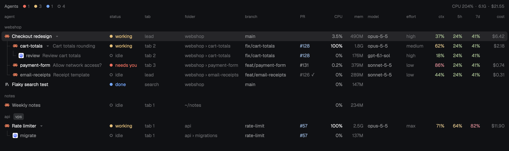
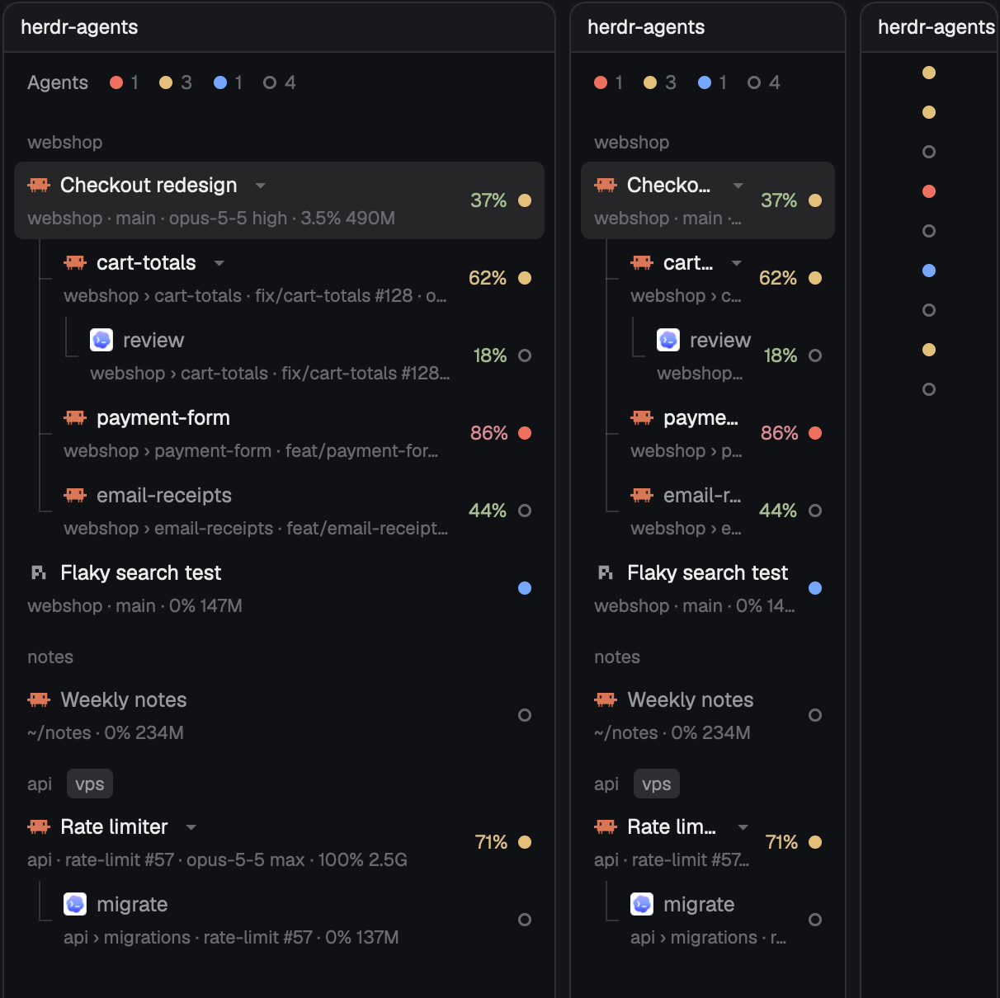

# herdr-agents

A table of every agent Herdr knows, one row each, on this machine and the others: what it is
doing, whose helper it is, where it sits in the window, the repository, branch and pull request
it works on, and how much CPU and memory it uses. When the agent's session keeps an
[agent-telemetry](https://github.com/evgenyt1/agent-telemetry) file, the row also shows its
model, effort, how full its context is, its limits and its cost. Clicking a row goes to that
agent.

## What you see

Top to bottom, on the theme's `chrome` background (`popover` when opened over the window), text
12.5px:

1. **Top bar**, 36px, all of it 11.5px: the word "Agents" (`muted`, medium weight), then one
   status dot with a count (`dim`) for each status that has agents, in the order blocked,
   working, done, idle, then agents Herdr has no status for; on the right, in the table layout
   only, the totals `CPU 204%  ·  6.1G  ·  $21.55` (`dim`). Agents folded away are counted. A
   bar too narrow for all of it gives up the word first, then counts, the least urgent first:
   no status, idle, working, done; blocked stays longest.
2. **Column headings**, 20px, 10.5px `dim`, in the table layout and only when there are rows:
   `agent`, then the columns below. With no agents, the line "No agents are running." (`dim`)
   stands there.
3. **Rows**, scrolling. Each space starts with a 24px heading (11px, medium, `dim`): the space's
   name, and the machine's name in a small `raised` pill when it is another machine. Under it,
   that space's agents as a tree: an agent started by another agent sits under it, 16px further
   in for each level, joined by 1px lines (`input` color; `border` in a theme without it) drawn
   the full row height so they meet between rows.

A table row is 26px, with 12px between columns:

| Column | Width | Shows | Color |
| --- | --- | --- | --- |
| agent | the rest, 190px at least | tree lines, the program's 14px icon (a picture as it is, a one-color glyph in `muted`), the name (the terminal's name, else its title, else its program), the fold control on a row with helpers, then the title in `dim` when it adds something | `foreground`; `muted` when idle |
| status | 82 | an 8px dot and `working`, `needs you`, `done` or `idle` | the status color |
| tab | 96 | the tab's name; `tab 2` when the name is only digits (a tab nobody named); `notes · tab 2` when the agent's tab is in another space than the one the row is listed under | `dim` |
| folder | 150 | the repository's name, then ` › ` and the worktree and the folder below the checkout, those two joined by ` / ` (`webshop › cart-totals / src`); outside a repository the path with home as `~` when it is one or two folders (`~/notes`), else `…/` and the last two | `dim` |
| branch | 136 | the branch; `@4a1b26c` when a commit is checked out | `muted` |
| PR | 58 | `#128`; `#126 ✓` when merged, the mark standing outside the number so a long number is cut and the mark is not; nothing when closed | open `accent`, draft `muted`, merged `dim` |
| CPU | 44, right | `0%`, `3.2%`, `145%`: the load of the agent's process and everything it started, 100% being one core | `muted`; `foreground` from 50% |
| mem | 44, right | `84M`, `1.3G` of the same processes | `dim` |
| model | 92 | the model without `claude-` and without a date stamp | `muted` |
| effort | 52 | as the file gives it | `dim` |
| ctx | 38, right | percent of the context window used | `ansi2` (green) under 50, `ansi3` (yellow) under 80, else `ansi1` (red) |
| 5h, 7d | 36 each, right | percent of the five-hour and seven-day limits used | the same three colors |
| cost | 54, right | `$0.42`, `$118` | `dim` |

A column no agent has anything for is left out: without telemetry files the last six are not
there. When the block is too narrow for all of them, columns go in this order, first to go
first: tab, 7d, 5h, folder, cost, effort, PR, mem, CPU, model, branch, ctx; status stays.

Under 520px wide the rows become two lines: icon, name and, right after the name, the fold
control above; folder, branch and pull request (`#126 ✓` when merged), model and effort, CPU
and memory in one `dim` 11px line below, joined by ` · ` and cut at the end when too long; the
context percent and the status dot on the right. Under 110px it is a rail: a column of
status dots, 24px each, no headings.

## How it behaves

- **Statuses**, in the theme's own `working`, `blocked`, `done` and `idle` colors: working is a
  filled dot that fades between 30% and 100% every 1.4 s; blocked ("needs you") and done are
  filled and still; idle is a 1.5px ring. An agent Herdr has no status for gets a ring in
  `unknown`.
- **Click a row**, or Enter on the row under the keyboard: Herdr goes to that agent
  (`agent.focus`). Opened over the window, the mod then closes, unless the `stay` prop is set.
- **Keys**, when the block has the keyboard: Down/`j`, Up/`k`, Home, End move the row marked
  with `hover`; Left folds a row's helpers, Right shows them again.
- **The fold control** (`▾`; folded `▸ 3`, the count of agents hidden) folds a row's helpers
  away. Folded, it takes the color of the most urgent hidden status (blocked, then done, then
  working), and hidden agents still count in the top bar.
- **Click a pull request number**: it opens in the browser. Hovering it shows `#126 merged` and
  its title.
- **Hover** a row: `hover` background; over the name (the whole row when it has two lines, the
  dot in the rail shows the name), a tip with the program, the terminal's address, the full
  folder, the branch and pull request, and the agent's last report. The row of the focused agent has the
  `selected` background.
- The order of the rows is also the order of `agent.next` and `agent.prev`, unless the mod was
  opened over the window or the `order` prop says otherwise.
- Nothing else moves. Rows redraw when something they show changes. On this machine processes
  are read every 5 s (the `refresh` prop), branches every 10 s, a telemetry file within a
  second of its change. On another machine processes are read every 15 s, branches and the
  telemetry folder every 30 s. Pull requests are asked every 2 minutes (5 when there is none).

## Built from

- One mod, `mods/herdr-agents/`: `main.js` (the view and the background reading), `lib/` (pure
  parts: `tree.js`, `ps.js`, `git.js`, `telemetry.js`, `format.js`), `demo.js` (made-up agents
  for the preview). `mod.json`: `{ "place": "none", "title": "Agents", "focusable": true,
  "overlay": { "width": 0.8, "height": 0.7 } }`. No layout, no keys, no shipped mods, no art.
- Props: `refresh` (seconds, 5), `telemetryDir`, `order`, `stay`, `background` (a theme color
  name), `demo`.
- `herdr` functions: `terminals()`, `agents()`, `spaces()` for the rows (an agent is a live
  terminal with a status, or whose program is marked as an agent; its `parent` gives the tree;
  the space and tab come from `agents()`, or from the nearest parent that has them);
  `exec(..., { on })` and `readTextFile(..., { on })` for everything read, here or on another
  machine; `watchFolder` for the telemetry folder; `setAgentOrder`; `run("agent.focus",
  { terminal })`; `closeOverlay`; `nextCommand` (it has no commands, the loop only ends on
  reload); `props`, `home`, `theme`.
- Programs, all read-only, never started from `render`: from a timer (`cx.timer.every`), except
  the watch of this machine's telemetry folder, which is a `cx.spawn` loop started in `init`:
  - `ps -axo pid=,ppid=,pcpu=,rss=,time=` per machine. CPU is the CPU time the agent's process
    tree gained between two readings about 20 s apart (a minute where `ps` counts whole
    seconds), not `pcpu`, which on Linux is the average since the process started.
  - `git rev-parse --path-format=absolute --show-toplevel --git-common-dir --git-dir
    --show-prefix`, once per folder, then `git symbolic-ref --short -q HEAD` (exit 1: a commit
    is checked out, ask `git rev-parse --short HEAD`).
  - `gh pr list --head <branch> --state all --limit 20 --json
    number,state,isDraft,url,title,isCrossRepository`, per repository and branch.
  - `gh --version`, only after a `gh` call could not be started, to tell a machine without `gh`
    (ask again in 10 minutes) from one that is away (in 1 minute).
  - `sh -c 'printf %s "${AGENT_TELEMETRY_DIR:-${XDG_CACHE_HOME:-$HOME/.cache}/agent-telemetry}"'`
    for the telemetry folder: on this machine when no `telemetryDir` prop is given, and on every
    other machine. `sh -c 'printf %s "$HOME"'` once on another machine, for `~` in its folders.
  - `ls -1 <folder>` to list the telemetry folder on another machine, and on this one when the
    folder is outside what a mod may list itself.
- Telemetry: files `<agent>-<session>.json`, format v1, in `$AGENT_TELEMETRY_DIR`, else
  `$XDG_CACHE_HOME/agent-telemetry`, else `~/.cache/agent-telemetry`. A file belongs to the
  terminal named in `terminal.hc`, else to the terminal whose program is its `pid` or started
  it.
- Processes, branches, pull requests and other machines' home folders are kept in one object
  for the whole module, so a second copy of the mod, or one opened again, shows them at once
  and does not ask twice. Telemetry records are kept by each copy: copies may be given
  different folders.

## Watch out

- Never keep `cx` past a callback, and never call `exec` from `render`: a draw must not wait.
- `fs` calls throw at once, not as a rejected promise, for paths outside the home folder; only
  `try { await ... }` catches that, and an uncaught one silently ends a `cx.spawn` loop.
- `watchFolder` rejects when the folder is missing: sleep and look again (30 s), do not spin.
  Writers rename a temporary file (`.name.tmp`) over the old one; skip those names and read
  only the files the watch reports.
- Skip a telemetry file with another `v`, one that does not parse, one whose `pid` is not
  running, and one without a `pid` that has not changed for six hours. Terminal ids are given
  out again: a file last written before its terminal was made is an earlier session's. A limit
  whose `resetsAt` has passed says nothing.
- `gh pr view <branch>` reads a branch named `123` as a pull request number; list by head.
- A linked worktree's repository name comes from the shared git folder, not from its own
  folder's name. Git before 2.31 prints `--path-format=absolute` back and answers with relative
  paths.
- `terminals()` can name parents in a loop; break it at a terminal on the loop.
- Each machine reads on its own, so one that is slow or away holds up nobody else. A machine
  with no `ps -axo` (Windows, BusyBox) gets no CPU and memory.
- A mod folder that is a symlink is not reloaded on save; install a copy.
- Assumes `git` and, for pull requests, a signed-in `gh` on each machine; without them those
  columns stay empty and nothing else changes.

## Done when

- `herdr-app check` on the mod passes, and passes on copies forced into demo mode at 1400, 700,
  300, 200, 120 and 60px wide (`scripts/check-renders.sh`).
- `node --test` passes: the tree, the process sums, git labels, telemetry matching, the number
  formats, the demo data.
- With `--props '{"demo": true}'` it shows nine agents in three spaces, one of them on another
  machine, with every status, a three-level tree and all the telemetry columns.
- With real agents and no telemetry folder, every row has its status, tab, folder, branch, CPU
  and memory, and there is no model, ctx, 5h, 7d or cost column.
- Writing a telemetry file for a running agent adds its figures to that row within a second;
  removing it takes them away.
- Clicking a row goes to that agent's tab and pane.
